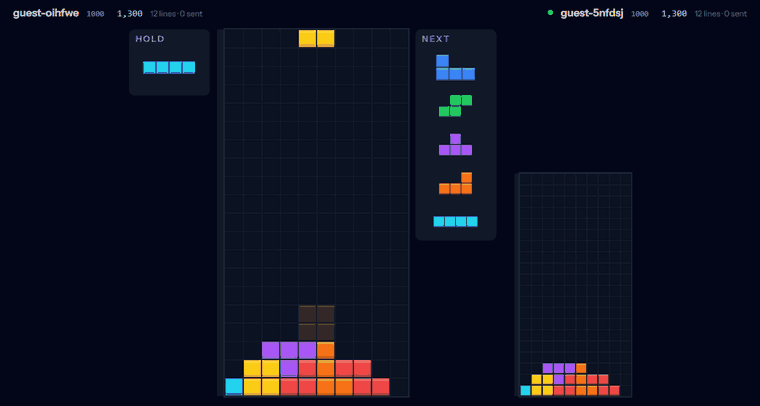
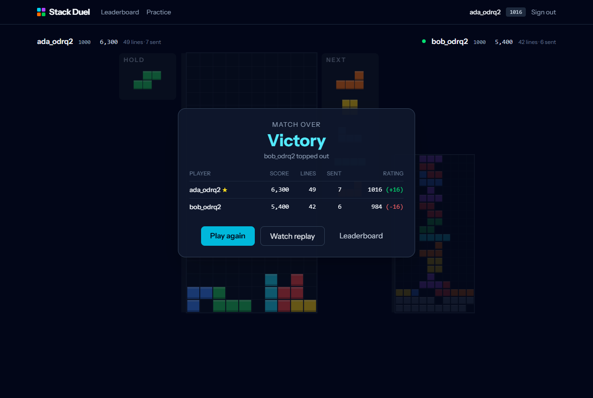
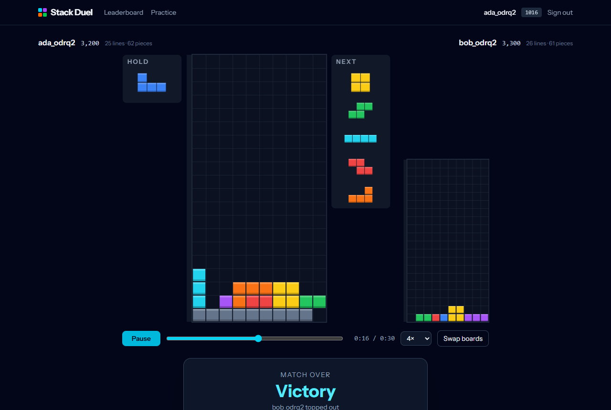
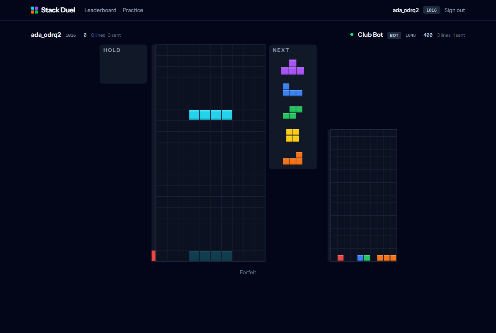
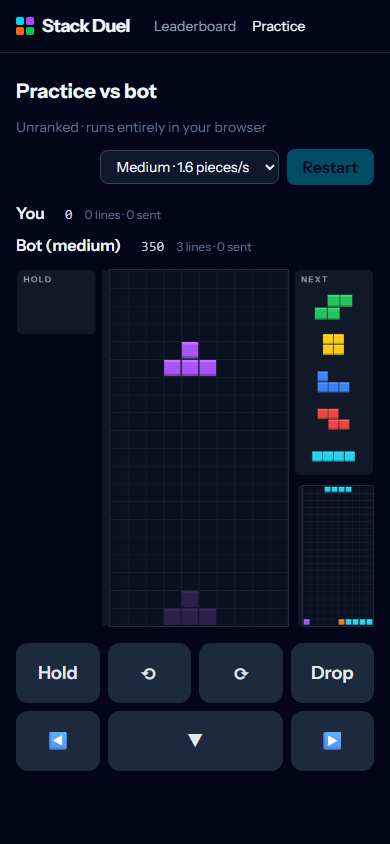
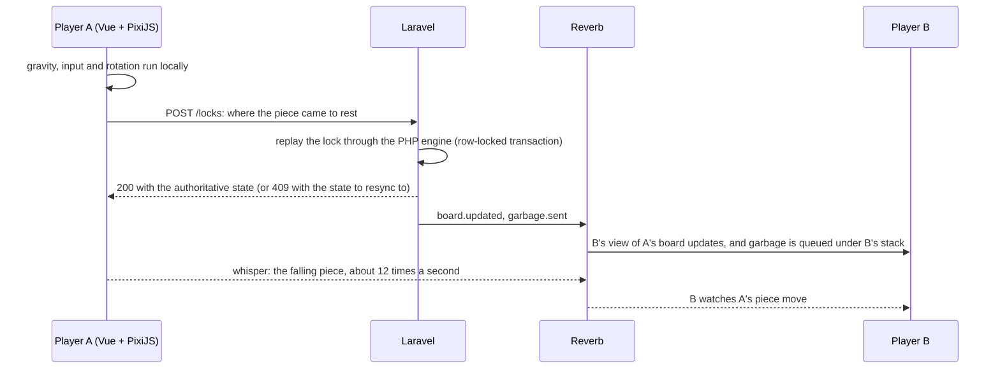

# Stack Duel

[](https://github.com/GodfreysDragon/stack-duel/actions/workflows/ci.yml)

A real-time 1v1 block-stacking battle in the browser. Two players are matched by rating and dealt the same seeded
pieces. Every line you clear sends garbage rows into your opponent's board, and the first player to top out loses.
If nobody else is queueing, a server-side bot steps in after 15 seconds. You can play as a guest in one click.

**[Play the live demo →](https://stackduel.duckdns.org)**



**Stack:** Laravel 13 · PHP 8.4 · Laravel Reverb + Echo (WebSockets) · Vue 3 + Vue Router · PixiJS 8 · Tailwind 4 ·
MySQL 8 or SQLite

| Result and Elo change | Replay viewer | Against a house bot | Phone |
|---|---|---|---|
|  |  |  |  |

## What's in it

- **Ranked 1v1** with Elo ratings (K=32), lifetime stats, a leaderboard and player profiles.
- **Rating-based matchmaking.** The acceptable rating gap widens the longer you wait (±150, plus 25 a second, up to
  ±1000).
- **House bots.** A player left alone for 15 seconds is paired with the closest-rated bot: Rookie, Club or Pro. Bots
  play on the server under exactly the same rules as players.
- **A full modern ruleset:** SRS rotation with wall kicks, hold, a 5-piece preview, a ghost piece, DAS/ARR and lock
  delay. Attacks come from combos, back-to-back tetrises and perfect clears.
- **Exact replays** of every finished match, with scrubbing, 0.5–4x speed and a board swap.
- **Practice mode** against a local bot, keyboard controls, and touch controls on phones.

## How it works



**The game engine exists twice, and the two copies are tested to agree.** The JS engine (`resources/js/engine`) runs
the real-time game in the browser. The PHP port (`app/Game`) validates it. After every lock, the client sends only
where the piece came to rest. The server replays that lock through its own engine and checks four things: the piece
is the right one for the seeded 7-bag and the hold, it is inside the field, it overlaps nothing, and it is resting on
something. The server then computes the line clears, score and attack itself. A fixture of 921 locks from bot games,
generated by the JS engine, is replayed through the PHP engine in the test suite after every change, so the two copies
can't drift apart.

**Concurrency.** A lock runs in a transaction that holds a row lock on the match. Two players' locks, and the garbage
they send each other, are therefore applied one at a time. The piece number makes each submission idempotent. A
rejected lock returns 409 with the authoritative state and the pending garbage, and the optimistic client resyncs to
it. Matchmaking runs under an atomic cache lock. Rating changes are applied as relative updates, because a bot can be
in many matches at once.

**Garbage.** An attack creates a garbage batch for the opponent, which is broadcast over Reverb. The opponent's client
raises it on its next lock that clears no lines and reports which batch ids it applied. The server checks that they
are the oldest pending batches, in order, and rejects any lock that skips a batch older than the 3-second grace
period.

**Bots.** `php artisan bots:play` is a single daemon that plays every bot match. It ports the JS bot's placement
search to PHP: height, holes, bumpiness and lines, over every drop of the current piece and the hold swap. It
submits each lock through the same `LockProcessor` that players use. The daemon is stateless: a bot's next piece is due
one interval after its last lock, so a restarted daemon picks up at the same pace.

**Leaving a match.** A running game sends a heartbeat every 5 seconds from its render loop, which stops when the tab is
hidden. If a player has had no heartbeat and no lock for 20 seconds, or no lock for 5 minutes, the opponent can claim
the win. `matches:expire-idle` ends matches that both players have abandoned, as a no contest.

### Security model

The server is authoritative for everything that affects ratings: piece order, legality, line clears, score, attack,
garbage, the result and Elo. It does **not** check whether a placement could be reached by real inputs, or how fast the
inputs came. A modified client could therefore place pieces faster than a human, or in spots that can't actually be
reached. Closing that gap would mean a reachability search (BFS over moves and rotations) and pace limits on the
server. They are the next items on the list. The bot autopilot used by the end-to-end test (`?autopilot=1`) is compiled
out of production builds.

## Running it locally

Requirements: PHP 8.3+, Composer and Node 20+.

```sh
composer setup                    # install, create .env and the key, migrate, build the frontend
php artisan db:seed               # two accounts, alice and bob (password: "password"), a leaderboard and the bots
composer run dev                  # app server, Vite, Reverb, the bot daemon, the scheduler and the queue
```

Open http://localhost:8040 in two browsers (or a normal window and a private one) and press **Play ranked** in both.
On your own, use **Play as a guest** and a house bot takes you on after 15 seconds.

To use MySQL instead of SQLite, set `DB_CONNECTION=mysql` and the `DB_*` values in `.env`.

<details>
<summary>Notes for Windows</summary>

- PHP's built-in server runs on the CLI SAPI, which often has opcache turned off. That makes every request take about
  500ms. For realistic timings, serve with opcache on. The command must run from `public/`, because Laravel's router
  script uses the working directory as the public path:
  `cd public && php -d opcache.enable_cli=1 -S 127.0.0.1:8040 ../vendor/laravel/framework/src/Illuminate/Foundation/resources/server.php`
- Use `REVERB_HOST=127.0.0.1`, not `localhost`. On Windows, `localhost` tries IPv6 first, which adds about 220ms to
  every broadcast.

</details>

## Deploying

`deploy/` sets up a single Ubuntu 24.04 server: Nginx in front of PHP-FPM and Reverb (wss:// on the same domain),
Supervisor keeping Reverb and the bot daemon running, cron for the scheduler, SQLite, and a Let's Encrypt
certificate. No queue worker is needed, because every broadcast is sent immediately.

```sh
sudo apt-get update && sudo apt-get install -y git                                 # minimal images lack it
git clone https://github.com/GodfreysDragon/stack-duel.git /tmp/stack-duel
sudo bash /tmp/stack-duel/deploy/setup.sh stack-duel.example.com you@example.com   # once
bash /var/www/stack-duel/deploy/update.sh                                          # each deploy
```

## Tests

```sh
php artisan test                  # PHPUnit: engine parity, rules, the bot, matchmaking, locks, garbage, Elo, channels, ...
npm run test:js                   # node:test: the JS engine, the game controller and the bot
npm run fixture                   # regenerate the parity fixture after changing the engine
```

CI runs the PHP suite on both SQLite and MySQL 8.4, the JS tests, Pint and Larastan (PHPStan level 6) on every push.

**End to end.** `tests/e2e/ranked-match.mjs` drives two headless browsers through a complete ranked match against a
running app. The steps are: registration, matchmaking, the countdown, 25 seconds of play with every lock validated,
garbage crossing over Reverb, a reload mid-match that resumes from server state, and a keyboard top-out. Then it checks
the result card and the symmetric Elo change, the profile, the leaderboard and the replay viewer. Finally it covers a
bot match, practice mode and the phone layout.

```sh
VITE_E2E_AUTOPILOT=true npm run build
php artisan reverb:start & php artisan bots:play &   # plus the app server (see the Windows notes above)
E2E_URL=http://127.0.0.1:8040 npm run test:e2e
```

## Controls

← → move · ↓ soft drop · Space hard drop · ↑/X rotate right · Z/Ctrl rotate left · A rotate 180° · C/Shift hold.
On touch devices, on-screen buttons appear under the board.

## License

[MIT](LICENSE) © 2026 Cal Marusin
